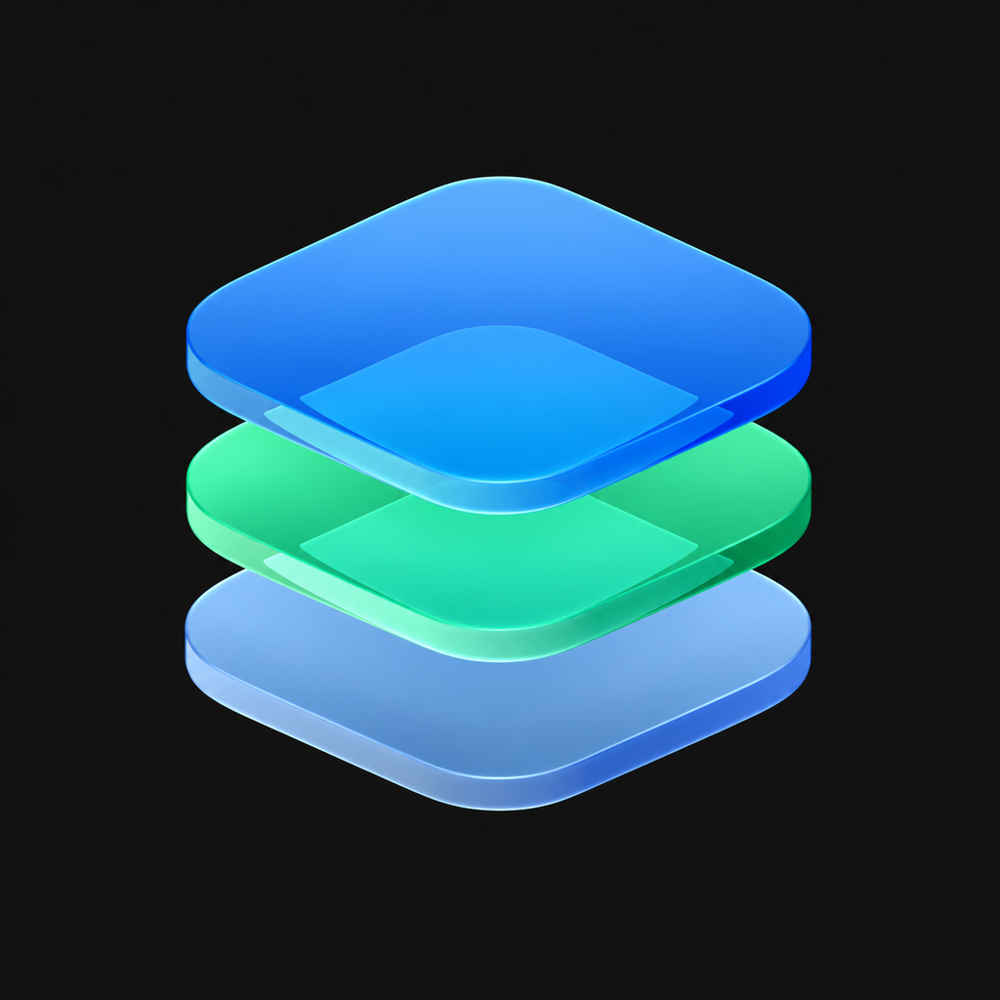

# Strata

> **Session navigation preview:** sin compilación Xcode ni prueba en iPhone. Ver [estado](docs/SESSION-NAVIGATION.md). Las verificaciones históricas de abajo corresponden al autor original.

A customizable launcher built on [LiveContainer](https://github.com/LiveContainer/LiveContainer), with three interface modes and bundled SideStore support.

<p align="center"></p>

## Three ways to browse your apps

- **iOS Home Screen:** portrait layout, wallpaper, pages, folders, dock favorites, search, and glass controls.
- **Cinematic:** landscape console interface with a horizontal app rail, backgrounds, and controller navigation.
- **Big Picture:** landscape library with portrait artwork, categories, and adjustable cover sizes.

Rename apps, choose custom icons from Photos, manage categories, and hide or restore apps separately in each mode. Console modes have separate artwork and layout preferences, adjustable Play buttons, and movable launch controls. Guest apps continue to use LiveContainer's registry and execution engine.

## Download and install

Find the latest IPA under [Releases](https://github.com/huzaifahshahid71-ops/Strata/releases). Revision 11 is an **experimental prerelease**.

Sign and install the IPA with SideStore. When updating an existing compatible combined installation, keep the current app and choose **Keep App Extensions**. Use the same signing account and app identity to preserve the existing container. Back up important guest data before changing installations. The download does not include personal certificates or pairing records.

## JIT and 32-bit apps: current status

The built-in JIT workflow uses StikJIT with an imported device pairing record, LocalDevVPN, Developer Mode, and suitable signing permissions. **Prepare device has passed on the test iPhone; actual guest JIT is not yet working in that test.** Revision 10 returned debugger attach error `E96`. Revision 11 requests a detailed error response to diagnose the rejection. It is not advertised as a working JIT fix.

The bundled official LiveExec32 nightly runtime installs through LiveContainer's normal guest installation path when needed. **LiveExec32 still requires JIT.** Bundling it does not create a JIT-less 32-bit interpreter, and compatibility depends on the upstream runtime.

## Build from source

```sh
git clone --recurse-submodules https://github.com/huzaifahshahid71-ops/Strata.git
cd Strata
python3 Scripts/fetch-bundled-dependencies.py
xcodebuild -project LiveContainer.xcodeproj -scheme LiveContainer \
  -configuration Release -sdk iphoneos -destination 'generic/platform=iOS' \
  CODE_SIGNING_ALLOWED=NO build
```

Use a compatible Xcode 26 or newer installation with the iPhoneOS SDK. The target remains named LiveContainer. The postbuild step assembles the dedicated JIT helper and copies the bundled runtime. An unsigned build must be signed before installation. The downloadable combined prerelease preserves the supplied LiveContainer 3.8.11 runtime and original SideStore extensions; a fresh source build is not byte-identical to that assembly.

Automated upstream release workflows are retained for reference but are manual-only in this fork. They have not been validated for publishing Strata builds. See [upstream documentation](docs/LiveContainer-Upstream.md) for execution architecture and dependencies.

## Verification

The revision 11 arm64 release build and six debugger-script regression cases pass. Earlier targeted iPhone/iPad simulator checks cover Home editing, mode separation, rename persistence, cover and Play-button sizing, positioning, and persistent JIT status. These checks do not establish successful live guest JIT, universal 32-bit compatibility, or physical-controller performance.

## Credits and licenses

This is a community modification, not an official LiveContainer, SideStore, Apple, PlayStation, or Steam release. LiveContainer and Strata modifications retain the repository's [AGPL-3.0 license](LICENSE). See [third-party notices](THIRD_PARTY_NOTICES.md) for StikJIT, idevice, LiveExec32, and other upstream components. The Strata icon adapts the project owner's supplied design. Existing Apple Music artwork used by the ByeTunes presentation override remains attributable to Apple.
