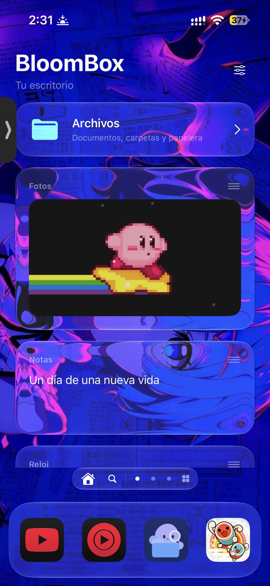
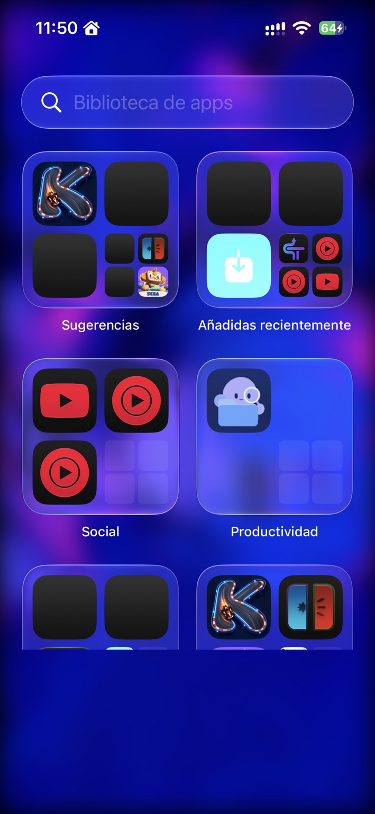
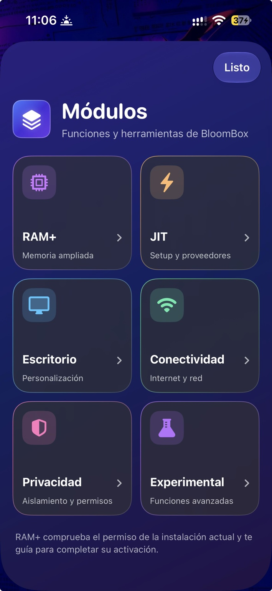
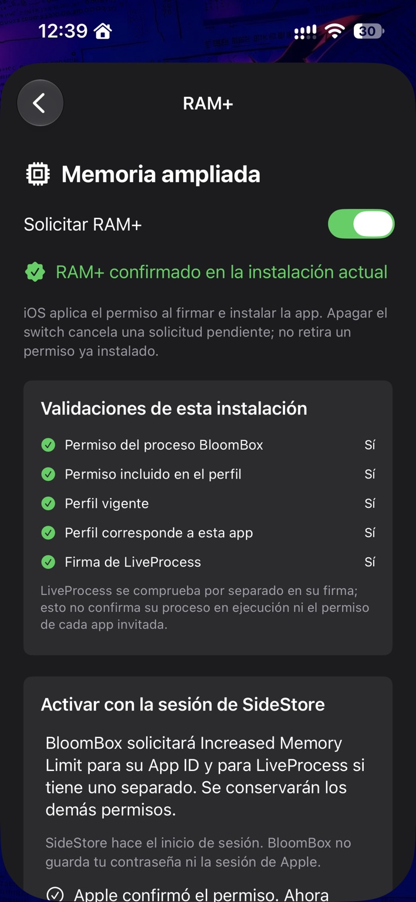
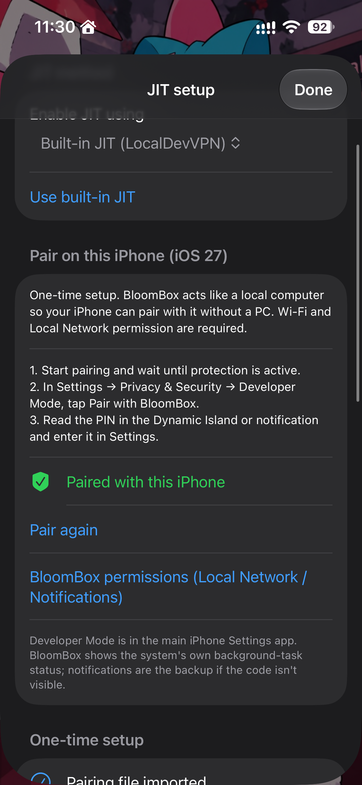
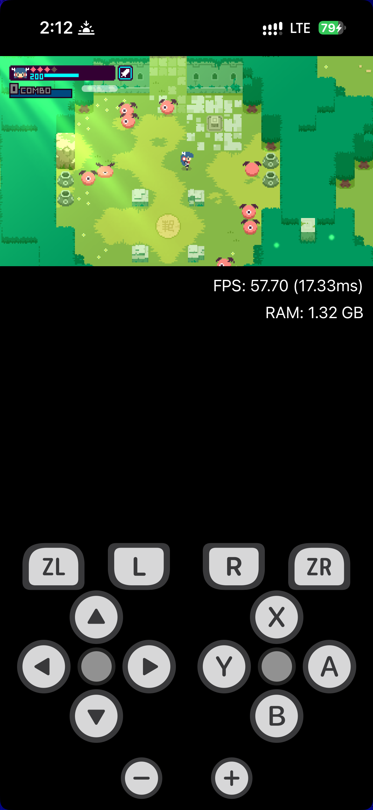

# BloomBox 🌸

### Less configuring. More enjoying your iPhone.

A personal home for your apps, widgets and files — with room to experiment.

[**Download BloomBox**](https://github.com/adri23rep-stack/BloomBox/releases) · [What's new](https://github.com/adri23rep-stack/BloomBox/releases/tag/v1.3.0) · [Report an issue](https://github.com/adri23rep-stack/BloomBox/issues)

**BloomBox is an independently maintained iOS launcher and application container built on LiveContainer technology.** Bring compatible apps into one customizable space, organize your desktop, discover community projects and manage files without leaving BloomBox.

Its home screen lives **inside the app**; it does not replace the iOS Home Screen. Experimental features are clearly identified below so you can choose what to try.

## A space that feels like yours

<table>
<tr>
<td align="center" width="33%"> <b>Your desktop, your style</b> Widgets, wallpaper and a familiar dock.</td>
<td align="center" width="33%"> <b>Your apps, organized</b> A searchable library alongside your home pages.</td>
<td align="center" width="33%"> <b>More control in one place</b> Modules brings advanced tools within reach.</td>
</tr>
</table>

*Real device screenshots from development builds, shown in Spanish. Appearance and available controls can differ by release. Third-party apps and wallpaper shown are not bundled with BloomBox.*

## What you can do

| Feature | What it brings to your iPhone |
| --- | --- |
| **Personal desktop** | Arrange apps, folders, pages and widgets with drag-and-drop controls. |
| **Liquid Glass & customization** | Personalize glass panels, app icons, themes and backgrounds. |
| **Animated wallpapers** | Use GIFs or silent looping videos to bring your desktop to life. |
| **App library & installation** | Import compatible IPAs and manage guest apps inside BloomBox. |
| **Community catalogs** | Browse the BloomBox App Store, game ports and Tweak Store, with links and author attribution. The BloomBox catalog is separate from Apple's App Store. |
| **Built-in files** | Import, preview, organize, move, copy and share documents, with folders and a trash area. |
| **Modules** | Find RAM+, JIT setup, desktop settings, connectivity controls and experimental options together. |
| **SideStore reminders** | An expiration Live Activity, with Dynamic Island presentation on supported devices. Device testing is still needed across configurations. |

## Experimental, with visible progress

These tools are part of active development. **Included in a release does not mean universally compatible.** Your iOS version, signing setup and the guest app all matter.

<table>
<tr>
<td align="center" width="33%"> <b>RAM+ validation</b> See the installed permission checks.</td>
<td align="center" width="33%"> <b>On-device JIT setup</b> Pairing and provider controls.</td>
<td align="center" width="33%"> <b>MeloNX in action</b> A real experimental gameplay test.</td>
</tr>
</table>

### RAM+ · increased memory limit

RAM+ requests Apple's Increased Memory Limit capability and checks whether it is present in the installed app and provisioning profile. **Activation was confirmed in a development test on an iPhone 14 Pro with iOS 27**, and MeloNX reported the increased limit enabled. This is a tested configuration, not a promise for every device or signer.

Activation and reinstallation are separate steps. SideStore must preserve the permission when signing; Apple approval alone does not activate it in the running app. RAM+ does not add physical RAM or enable JIT.

The v1.3.0 reinstall flow can fail to locate or accept a matching IPA. A [latest-release installer fix is being developed separately](https://github.com/adri23rep-stack/BloomBox/tree/fix/ramplus-latest-release-installer); it is not part of v1.3.0. See the [RAM+ implementation and validation notes](docs/BloomBox-RAMPlus.md) for the current flow and fallback details.

### JIT · built-in setup, guest-specific testing

BloomBox includes experimental on-device pairing and built-in JIT integration for **guest apps inside BloomBox**. LocalDevVPN, Developer Mode and correctly signed extensions are required. Pairing success and debugger attachment are not, by themselves, proof that a guest can use JIT.

The gameplay screenshot above comes from **MeloNX 2.6 development testing**. Its dedicated integration is on the [experimental MeloNX branch](https://github.com/adri23rep-stack/BloomBox/tree/experimental/melonx-26-jit), separate from v1.3.0. It does not require a separate StikDebug installation. The visible frame rate is one captured moment, not a benchmark or a guarantee for other games.

See [built-in JIT setup](docs/Manzana-OnDevice-JIT.md) and the [MeloNX experiment notes](https://github.com/adri23rep-stack/BloomBox/blob/experimental/melonx-26-jit/docs/MeloNX-2.6-JIT.md). Some technical notes retain earlier project names.

### Per-app internet controls

Choose which guest apps should have internet access from **Modules → Connectivity**. Close and reopen BloomBox to apply changes. This is an experimental guest-app filter, not a system-wide firewall: some connections, including iCloud-related traffic, may continue.

### App data export & import

Move supported guest-app data between installations using **App Settings → Export / import data**. Restore into the same guest app/version with the guest closed. Existing profiles are retained during import.

Backups do not include the guest IPA, and cloud sessions or device-bound credentials may not transfer. **These backup archives are not password-encrypted and may contain private data and accessible credentials.** See [backup coverage and limitations](docs/APP_DATA_BACKUPS.md).

## Get started

1. Open [Releases](https://github.com/adri23rep-stack/BloomBox/releases) and choose the newest **BloomBox app release** appropriate for you. Read its notes; other assets, such as tweak releases, are separate.
2. Download **`BloomBox-SideStore-unsigned.ipa`** from that release's assets.
3. Sign and install it with **SideStore**, retaining all app extensions. The downloaded IPA is unsigned and cannot be installed by opening it alone.
4. Open BloomBox, import a compatible guest IPA, and make the desktop yours. Open **Modules** when you want to explore advanced features.

**Updating?** Keep the same signing account, team and compatible bundle identity, and back up important data first. Do not delete BloomBox just to refresh or retry RAM+: deleting the app can remove its local data.

For development builds, use a successful [BloomBox - Build workflow run](https://github.com/adri23rep-stack/BloomBox/actions/workflows/build.yml) and check its branch before downloading the artifact. Development builds may contain unfinished changes; a successful build is not an on-device compatibility test.

## Questions before installing

**Will every IPA work?**

No. Guest compatibility depends on LiveContainer, the app's requirements, your device and signing configuration. Apps that need JIT may require additional setup or a guest-specific experiment.

**Is RAM+ the same as JIT?**

No. RAM+ concerns the permitted memory limit; JIT concerns executing code generated at runtime. Check them separately.

**Why are there LiveContainer, Manzana or Strata names in the source?**

BloomBox evolved from those projects. Some internal names remain to preserve settings, signing compatibility and guest data. The app's current display branding is BloomBox.

**Where can I check progress?**

[Releases](https://github.com/adri23rep-stack/BloomBox/releases) show published changes, [Actions](https://github.com/adri23rep-stack/BloomBox/actions) shows build results, and [Issues](https://github.com/adri23rep-stack/BloomBox/issues) tracks reports. Experimental branches should not be assumed to be included in a release.

## Help BloomBox grow

A useful bug report includes your device, iOS version, BloomBox version or branch, installation method, guest app/version and steps to reproduce. For RAM+ or JIT, include the relevant status screen and the stage that failed. Remove account details, pairing files and credentials before sharing logs.

[Report a bug or suggest a feature](https://github.com/adri23rep-stack/BloomBox/issues). Contributions to compatibility testing, documentation, translations and development are welcome. If BloomBox is useful to you, a star helps others discover the project.

## Open source, with credit where it belongs

BloomBox is a separate, independently maintained GitHub project — not code written from scratch. Its Git history and copyright notices are preserved from [Manzana](https://github.com/adri23rep-stack/Manzana), with original foundations from [Strata](https://github.com/huzaifahshahid71-ops/Strata) and [LiveContainer](https://github.com/LiveContainer/LiveContainer).

### RAM+ acknowledgments

Thank you to the developers whose work informed BloomBox's RAM+ integration:

| Project | Creator / team and contributors | Contribution to BloomBox |
| --- | --- | --- |
| [GetMoreRam](https://github.com/hugeBlack/GetMoreRam) | [hugeBlack](https://github.com/hugeBlack) and contributors | Reference for requesting Apple's Increased Memory Limit capability. |
| [StosSign](https://github.com/stossy11/StosSign) | [stossy11](https://github.com/stossy11) and contributors | Developer Services capability-request reference used by GetMoreRam and consulted for RAM+. |
| [SideSign](https://github.com/SideStore/SideSign) | [SideStore team](https://github.com/SideStore) and contributors | Reference for App ID lookup and signing-related integration. |
| [SideStore](https://github.com/SideStore/SideStore) | [SideStore team](https://github.com/SideStore) and contributors | The bundled authentication, signing and installation workflow. |

BloomBox implements its own RAM+ request and validation flow. GetMoreRam and StosSign are protocol references; their authentication source is not bundled into BloomBox. SideStore handles authentication.

### JIT & on-device pairing acknowledgments

BloomBox's built-in JIT work builds on the following projects and their contributors:

| Project | Creator / team and contributors | Contribution to BloomBox |
| --- | --- | --- |
| [StikJIT](https://github.com/StikDebug/StikJIT) | [StikDebug team](https://github.com/StikDebug) and contributors | Vendored JIT integration, with Swift adaptations in BloomBox's helper extension. |
| [Husk](https://github.com/Leviidev/Husk) | [Leviidev](https://github.com/Leviidev) and contributors | On-device pairing implementation adapted for BloomBox. |
| [idevice](https://github.com/jkcoxson/idevice) | [jkcoxson](https://github.com/jkcoxson) and contributors | Device communication used by the pairing and JIT components. |
| [MeloNX](https://starforgejo.dev/projects/MeloNX) | [stossy11](https://github.com/stossy11) and MeloNX contributors | Upstream JIT script used by the separate experimental MeloNX 2.6 profile. |

The MeloNX script attribution applies to the experimental branch, not the v1.3.0 release. Its [original script source](https://starforgejo.dev/projects/MeloNX/src/tag/2.6/src/MeloNX/MeloNX/Common/JIT/EnableJIT.swift) and [license](https://starforgejo.dev/projects/MeloNX/src/tag/2.6/LICENSE.txt) remain available upstream.

These acknowledgments do not imply endorsement by the original developers. Their copyright notices and component licenses remain in effect.

It remains under the [AGPL-3.0 license](LICENSE). Husk pairing components retain their stated GPL-2.0-or-later license; other components retain their respective licenses. See [third-party notices](THIRD_PARTY_NOTICES.md) and [screenshot provenance](screenshots/showcase/README.md).
